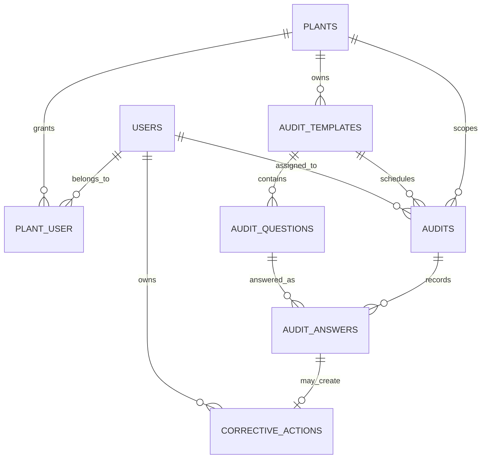
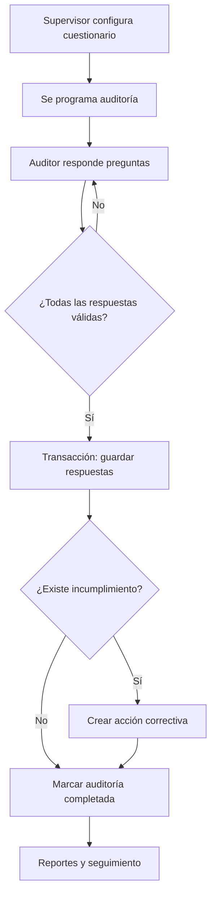

# Arquitectura técnica — PlantCore LPA

## Propósito y límites

Aplicación Laravel/Blade para planificar, ejecutar y consultar auditorías de proceso por capas, con control de acceso por planta. El entorno de evaluación utiliza datos ficticios y acceso delimitado por planta.

## Componentes

| Capa | Implementación | Responsabilidad |
| --- | --- | --- |
| Presentación | Blade, AdminLTE 4, Bootstrap 5 y Vite | Formularios, listados, calendario y reportes |
| Rutas HTTP | `routes/web.php` | Autenticación y operaciones web |
| Controladores | `app/Http/Controllers/Lpa*Controller.php` | Validaciones, filtros, operaciones y exportaciones |
| Autorización | `app/Support/LpaAccess.php` | Rol del usuario por planta y permisos |
| Persistencia | Eloquent y migraciones | Plantas, cuestionarios, programación, respuestas, acciones |
| Pruebas | `tests/Feature` | Flujos, aislamiento, permisos, reportes y datos ficticios |

## Modelo de datos

- `plant_user` asigna `viewer`, `auditor` o `supervisor` a cada usuario **por planta**, no globalmente.
- `audit_templates` define planta, área y nivel (1–5); `audit_questions` contiene las preguntas ordenadas.
- `audits` almacena asignación, fecha y estado; `audit_answers` conserva la respuesta `pass`, `fail` o `na`.
- `corrective_actions` se relaciona con una respuesta no conforme. Incluye responsable, fecha objetivo y cierre verificado por supervisor, con evidencia privada y registro de la verificación.

## Permisos

| Acción | Viewer | Auditor | Supervisor |
| --- | :---: | :---: | :---: |
| Consultar información de su planta | Sí | Sí | Sí |
| Programar / ejecutar auditorías | No | Sí | Sí |
| Administrar cuestionarios | No | No | Sí |
| Cambiar fechas y cerrar acciones | No | No | Sí |

Las operaciones validan primero la pertenencia a planta. El sistema devuelve 404 si el usuario no pertenece a la planta y 403 si pertenece pero no tiene permiso. Estas verificaciones se realizan en controladores mediante `LpaAccess`, no solamente ocultando botones.

## Flujo de una auditoría

La finalización emplea una transacción y bloqueo de la auditoría para evitar procesar simultáneamente dos cierres. Cada resultado `fail` exige una nota y genera una acción correctiva. Las listas que ya se programaron no permiten editar sus preguntas, para preservar la interpretación de auditorías históricas.

## Decisiones y riesgos conocidos

1. **SQLite para evaluación**: facilita la instalación, pero una aplicación industrial con varios usuarios concurrentes requeriría validar una base de datos apropiada y pruebas de carga.
2. **Roles asignados por planta**: impiden la consulta transversal desde los controladores; cualquier endpoint nuevo debe reutilizar esta regla explícitamente.
3. **Generación por lotes**: limita a 60 auditorías por operación y omite fechas repetidas; la comprobación de duplicados es de aplicación, no una restricción única en base de datos. La concurrencia real requiere reforzar la restricción.
4. **Cuestionarios históricos**: se inmovilizan después de programar auditorías. Una versión industrial debería registrar versiones explícitas de cada cuestionario y su vigencia.
5. **Acciones correctivas**: permiten adjuntar evidencia privada y requieren verificación documentada por un supervisor para el cierre. El seguimiento de eficacia posterior al cierre, las notificaciones automáticas y una bitácora inmutable quedan fuera del alcance actual.
6. **Exportaciones CSV**: limitan los registros según las plantas visibles y neutralizan prefijos que podrían interpretarse como fórmulas en hojas de cálculo.
7. **Operación en entornos reales**: requiere definir respaldos verificables, observabilidad, conservación de evidencias y evaluación de seguridad según el entorno de despliegue.

## Validación

El workflow `.github/workflows/tests.yml` instala dependencias, compila activos Vite y ejecuta `php artisan test`. La documentación de instalación y datos de ejemplo está en [README](../README.md); la secuencia para recorrer el sistema está en [Guía de evaluación](REVIEWER_GUIDE.md).
